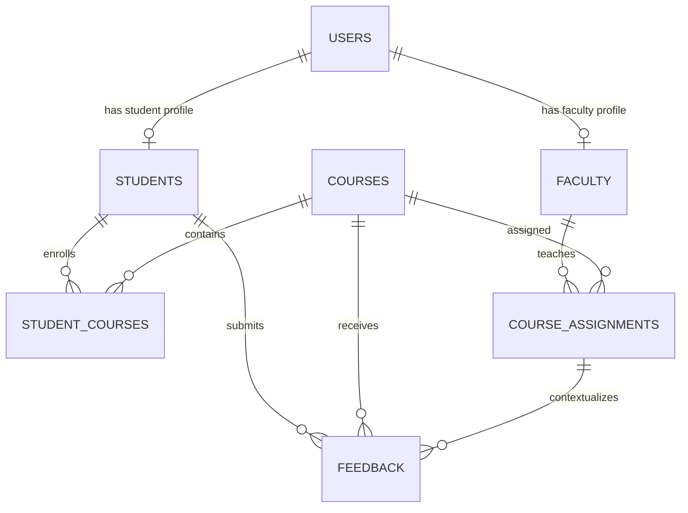

# Student Feedback Management System

A coursework-sized Flask application for anonymous course feedback. The implementation is staged: database and authentication first, then student/faculty workflows, then administration and aggregate reports. SQLite is used so the application runs locally without a separate database server.

## 1. Project Structure

```text
feedback-management/
├── feedback_app/
│   ├── __init__.py                 # App factory, extensions, blueprints, startup schema
│   ├── admin.py                    # Admin CRUD, enrollments, assignments, reports, CSV
│   ├── auth.py                     # User model, login, student registration, logout
│   ├── db.py                       # SQLite connection lifecycle and init-db command
│   ├── decorators.py               # Role-based access decorator
│   ├── faculty.py                  # Faculty-scoped anonymous summaries and comments
│   ├── schema.sql                  # Normalized schema and demonstration INSERT statements
│   ├── student.py                  # Enrollment view and feedback submit/edit/delete
│   ├── static/style.css            # Application styling
│   └── templates/
│       ├── base.html               # Shared navigation, flash messages, CSRF field pattern
│       ├── auth/                   # Login and student registration
│       ├── student/                # Student dashboard and feedback form
│       ├── faculty/                # Faculty dashboard
│       └── admin/                  # Admin dashboard, edit forms, reports
├── tests/test_app.py               # Flask test-client workflow tests
├── .gitignore
├── requirements.txt
├── run.py                          # Local development entry point
└── README.md
```

The `instance/` directory and SQLite database are created automatically on first startup. A local `.venv/` is created during setup and is not part of the source tree.

### File Guide

- [run.py](run.py) starts the development server through the app factory.
- [feedback_app/__init__.py](feedback_app/__init__.py) configures Flask, CSRF, login sessions, database initialization, and route blueprints.
- [feedback_app/schema.sql](feedback_app/schema.sql) is the complete SQLite DDL and sample-data script.
- [feedback_app/db.py](feedback_app/db.py) opens one parameterized SQLite connection per request and exposes `flask init-db`.
- [feedback_app/auth.py](feedback_app/auth.py) hashes passwords, registers students, authenticates users, and logs out.
- [feedback_app/decorators.py](feedback_app/decorators.py) enforces role-based route access.
- [feedback_app/student.py](feedback_app/student.py) limits feedback to a student's enrollments, validates ratings, and enforces the edit window.
- [feedback_app/faculty.py](feedback_app/faculty.py) calculates averages and loads comments without selecting student identities.
- [feedback_app/admin.py](feedback_app/admin.py) manages accounts, courses, assignments, enrollments, reports, and CSV downloads.
- [feedback_app/templates/base.html](feedback_app/templates/base.html) is the shared Jinja layout; role templates provide the relevant workflows.
- [feedback_app/static/style.css](feedback_app/static/style.css) contains the responsive presentation styles.
- [tests/test_app.py](tests/test_app.py) tests registration, feedback, role boundaries, anonymity, and reports.

## 2. Database Schema and SQL

The complete executable script is [feedback_app/schema.sql](feedback_app/schema.sql). It creates tables and constraints, then inserts demo accounts, courses, one faculty assignment, and student course enrollments. Flask also runs this idempotent script automatically at startup; use `flask --app run init-db` to explicitly initialize it.

The design separates account credentials (`users`) from student and faculty profile data. `student_courses` records enrollment by semester, while `course_assignments` records which faculty teaches which course in that semester. `feedback` references both relationships, restricts each score to 1-5, and has `UNIQUE(student_id, course_id, semester)` to prevent duplicate submissions. Foreign keys are enabled on every application connection.

The structure follows 3NF for this scope: non-key profile attributes depend on their profile key; course and user details are stored once rather than copied into enrollment or feedback; semester-specific relationships are represented by their own keys; and ratings/comments depend on the feedback record. Role is an attribute of the account rather than a duplicated profile value.

**ER diagram**



## 3. Backend and Authentication

Authentication uses Werkzeug password hashing and Flask-Login's signed session cookie. Login is required for role routes, and the role decorator rejects cross-role requests with HTTP 403. Every state-changing form is protected by Flask-WTF CSRF tokens. SQL values use placeholders; HTML output is auto-escaped by Jinja. The database uniqueness constraint is the final guard against duplicate feedback, even if two submissions race.

Student self-registration creates only a student account. The administrator creates faculty accounts and assigns students to courses. Feedback is anonymous to faculty: faculty queries use course-assignment IDs and never select the submitting student's identity. Administrators can see student identity in the all-feedback report.

## 4. Frontend

Jinja templates provide login and registration pages, a student course/history dashboard and rating form, a faculty averages/comments dashboard, and admin account/course/assignment/enrollment management plus reports. Bootstrap 5 is loaded from its public CDN; an internet connection is needed for Bootstrap's styles and interactive alert dismissal. The application stylesheet still provides the main layout if the CDN is unavailable.

## 5. Install and Run (Windows PowerShell)

Prerequisites: Python 3.10 or newer and an internet connection for installing the Python packages. No MySQL server is required.

```powershell
python -m venv .venv
.\.venv\Scripts\Activate.ps1
python -m pip install -r requirements.txt
$env:SECRET_KEY = "replace-this-with-a-long-random-secret"
python run.py
```

Open `http://127.0.0.1:5000`. The first run creates `instance/feedback.sqlite3` and loads the sample records. To initialize explicitly, stop the server and run `python -m flask --app run init-db`.

To run the automated tests:

```powershell
python -m unittest discover -s tests -v
```

Use the same virtual environment for the server and tests. For local development, `run.py` enables Flask debug mode; do not deploy it as a production server. Set a strong, private `SECRET_KEY` outside source control for any shared or deployed environment.

**Demonstration accounts** (all use password `DemoPass123!`):

- Admin: `admin@feedback.local`
- Faculty: `faculty@feedback.local`
- Student: `student@feedback.local`

Change or remove these demonstration accounts before using real student data.

## 6. Sample Test Cases

| Case | Input/action | Expected result |
|---|---|---|
| Valid student registration | Valid name/email, unique student number, password of 8+ characters | Account saved with a password hash; login is available |
| Invalid registration | Malformed email, duplicate email/number, or short password | Validation message; no account created |
| Valid feedback | Enrolled student submits three integer ratings from 1 to 5 | One anonymous record is saved |
| Invalid feedback | Rating is 0, 6, non-numeric, or missing | Validation message; no record saved |
| Duplicate feedback | Submit twice for the same student/course/semester | Unique constraint prevents a second row |
| Feedback edit/delete | Student changes or removes their own submission within 24 hours | Change succeeds; attempt outside the window is refused |
| Cross-role access | Student requests `/admin/dashboard` | HTTP 403; no admin data rendered |
| Faculty privacy | Faculty opens their dashboard after feedback is submitted | Scores/comments appear; student name is absent |
| CSV report | Admin requests a course or faculty export | Downloaded CSV contains aggregate rows and headers |
| CSRF | POST a state-changing form without a valid token | Request is rejected by Flask-WTF |

Automated checks cover the main workflows in `tests/test_app.py`. CSRF is enabled in normal app configuration; test-client tests disable it to focus on business behavior.

## 7. Project Report Outline

- **Abstract:** A role-based web system for collecting and summarizing anonymous feedback on courses and faculty.
- **Objectives:** Secure accounts, structured 1-5 ratings, anonymous faculty views, admin oversight, and downloadable aggregate reports.
- **System design:** Flask request/response flow, Jinja presentation layer, role-based routes, normalized SQLite schema, and foreign-key relationships.
- **Modules:** Authentication, student enrollment and feedback, faculty dashboards, admin management, and report/CSV generation.
- **Future scope:** MySQL deployment, email verification/password reset, configurable survey questions, semester scheduling, pagination, charts, and audit logging.

## 8. Likely Viva Questions

1. **Why use SQLite?** It keeps setup simple and is built into Python while still supporting relational constraints and transactions.
2. **How are passwords stored?** Werkzeug stores a salted, slow password hash; plaintext passwords are never written to the database.
3. **How is access control enforced?** Login sessions authenticate users, and a role decorator checks each protected route before its handler runs.
4. **How is feedback anonymous?** Faculty queries return feedback linked to their assignments but do not select or display the student account.
5. **How are duplicate submissions prevented?** A database unique constraint on student, course, and semester enforces one row per evaluation period.
6. **What prevents SQL injection?** User-supplied values are passed as SQLite query parameters instead of concatenated into SQL.
7. **What is CSRF protection?** Flask-WTF adds a session-bound token to state-changing forms and rejects missing or invalid tokens.
8. **How does the schema reach 3NF?** Profiles, courses, enrollments, assignments, and feedback each store facts in the table keyed by their own entity or relationship.
9. **How are report averages calculated?** SQL groups feedback by course, faculty, or semester and averages the three 1-5 rating dimensions.
10. **What does the feedback edit window do?** It allows the author to change or delete a submission for 24 hours after creation; the duration is controlled by `FEEDBACK_EDIT_HOURS`.

## Assumptions and Scope

- Semester strings use `YYYY-Spring`, `YYYY-Summer`, or `YYYY-Fall`.
- An administrator provisions faculty, course offerings, and student enrollments.
- A student submits at most one feedback record per course and semester, even if more than one faculty member is assigned.
- The 24-hour editing window begins at initial submission and is not extended by edits.
- Faculty anonymity protects the student's account identity in the application; students should avoid including identifying details in free-text comments.
- Deleting a course, assignment, or student physically removes dependent enrollment/feedback rows through declared cascade rules. Admin pages require confirmation before destructive actions.
