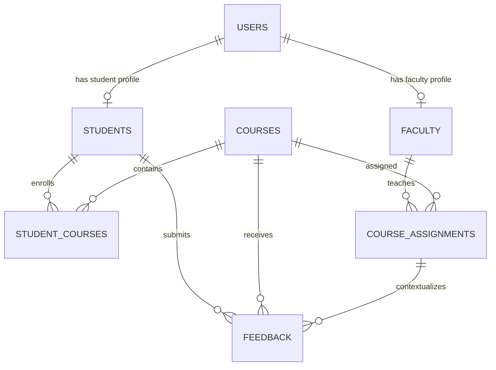

# Student Feedback Management System

[](https://ashishforcode.github.io/feedback-management/)
[](https://flask.palletsprojects.com/)
[](https://www.sqlite.org/)

> **🌐 Live Interactive Demo:** Test the Student, Faculty, and Admin workflows directly in your browser on GitHub Pages at **[https://ashishforcode.github.io/feedback-management/](https://ashishforcode.github.io/feedback-management/)**.

A coursework-sized Flask application for anonymous course feedback. The implementation is staged: database and authentication first, then student/faculty workflows, then administration and aggregate reports. SQLite is used so the application runs locally without a separate database server.

## 1. Project Architecture & Structure

The codebase is organized following a **3-Layer Architecture** (Presentation $\rightarrow$ Service $\rightarrow$ Repository) to isolate database queries, business rules, and HTTP handling:

```text
feedback-management/
├── .github/workflows/ci.yml        # Automated CI: Ruff linting, formatting & test suite
├── .env.example                    # Blueprint for environment variables
├── .pre-commit-config.yaml         # Git pre-commit hooks for formatting & linting
├── pyproject.toml                  # PEP 517/621 packaging & tool config (Ruff, Pytest, Mypy)
├── requirements.txt                # Production dependencies
├── requirements-dev.txt            # Development & testing tooling
├── run.py                          # Local development entry point
│
├── feedback_app/                   # Main Application Package
│   ├── __init__.py                 # App factory, extensions, healthz probe, blueprints
│   ├── config.py                   # Environment configuration (Dev, Test, Prod)
│   ├── db.py                       # SQLite connection lifecycle and smart schema init
│   ├── decorators.py               # Role-based access control (@roles_required)
│   ├── schema.sql                  # Normalized SQLite DDL & seed data
│   │
│   ├── repositories/               # Data Access Layer (Isolated SQL Queries)
│   │   ├── admin_repository.py     # User CRUD, course management, assignments, reports
│   │   ├── faculty_repository.py   # Teaching summaries, custom forms DDL, response stats
│   │   ├── feedback_repository.py  # Student enrollments, feedback submissions, window checks
│   │   └── user_repository.py      # User lookup, authentication, student registration
│   │
│   ├── services/                   # Business Logic Layer (Framework-Agnostic Rules)
│   │   ├── admin_service.py        # Account rules, CSV export with formula injection escaping
│   │   ├── auth_service.py         # Credential checks, role endpoints, URL sanitization
│   │   ├── faculty_service.py      # Question validation, rating distribution & yes/no analytics
│   │   └── feedback_service.py     # 1-5 rating validation, 24h edit window, form responses
│   │
│   ├── static/style.css            # Responsive application styling
│   └── templates/                  # Jinja Presentation Layer
│       ├── base.html               # Shared navigation, flash messages, CSRF field
│       ├── auth/                   # Login and registration views
│       ├── student/                # Student dashboard, feedback form, custom form fill
│       ├── faculty/                # Faculty dashboard, form builder, analytics view
│       └── admin/                  # Admin dashboard, edit modals, aggregate reports
│
├── tests/                          # Modular Automated Test Suite
│   ├── conftest.py                 # Pytest fixtures (app, client, auth, db)
│   ├── base.py                     # BaseTestCase with isolated SQLite lifecycle
│   ├── test_app.py                 # Unified test suite runner
│   ├── test_auth.py                # Authentication, registration, and session tests
│   ├── test_student.py             # Feedback submission, rating validation, form participation
│   ├── test_faculty.py             # Anonymous metrics, form builder, question analytics
│   ├── test_admin.py               # User/course management, reports, and CSV exports
│   └── test_security.py            # RBAC boundaries, redirects, /healthz probe
│
├── Dockerfile                      # Container deployment configuration
├── Procfile                        # WSGI process definition for Render & Railway
├── render.yaml                     # Render Blueprint specification
└── README.md
```

### File & Layer Guide

- **Presentation Layer (Blueprints)**: `admin.py`, `auth.py`, `faculty.py`, `student.py` handle HTTP routing, cookie sessions, and template rendering.
- **Service Layer (`services/`)**: Validates input formats, executes domain rules (e.g. 24-hour edit windows, question sanitization), and calculates analytics.
- **Repository Layer (`repositories/`)**: Executes parameterized SQL queries with clean transaction rollbacks on integrity errors.
- **Configuration Layer (`config.py`)**: Environment-specific settings (`DevelopmentConfig`, `TestingConfig`, `ProductionConfig`) with automated `.env` loading.
- **Health Check Probe (`/healthz`)**: Verifies web server and database connectivity for cloud orchestrators (Render, Docker).

## 2. Database Schema and SQL

The complete executable script is [feedback_app/schema.sql](feedback_app/schema.sql). It creates tables and constraints, then inserts demo accounts, courses, one faculty assignment, and student course enrollments. Flask also runs this idempotent script automatically at startup; use `flask --app run init-db` to explicitly initialize it.

The design separates account credentials (`users`) from student and faculty profile data. `student_courses` records enrollment by semester, while `course_assignments` records which faculty teaches which course in that semester. `feedback` references both relationships, restricts each score to 1-5, and has `UNIQUE(student_id, course_id, semester)` to prevent duplicate submissions. Foreign keys are enabled on every application connection.

The structure follows 3NF for this scope: non-key profile attributes depend on their profile key; course and user details are stored once rather than copied into enrollment or feedback; semester-specific relationships are represented by their own keys; and ratings/comments depend on the feedback record. Role is an attribute of the account rather than a duplicated profile value.

**ER diagram**



## 3. Backend and Authentication

Authentication uses Werkzeug password hashing (PBKDF2/Scrypt) and Flask-Login's signed session cookies. Key features include:

- **Role-Based Access Control (RBAC):** Authenticated users belong to one of three roles: `student`, `faculty`, or `admin`. Access is strictly enforced via the `@role_required` decorator; unauthorized attempts return HTTP 403 Forbidden.
- **1-Click Quick Demo Sign-In:** Both the Flask application (`/auth/login`) and the GitHub Pages live showcase (`index.html`) feature 1-click demo credentials autofill for Student, Faculty, and Admin personas.
- **Session Persistence ("Remember Me"):** Optional session cookie extension supported by Flask-Login.
- **Password Visibility Toggles:** Interactive eye icons on login and registration password inputs for enhanced user convenience.
- **CSRF Protection:** Every state-changing form is protected by Flask-WTF CSRF tokens.
- **Account State Verification:** Inactive or suspended accounts are detected during credential verification and blocked with clear feedback.
- **Strict Anonymity:** Faculty queries join feedback records through `course_assignments` and deliberately omit student identifiers from SQL `SELECT` clauses.
- **Self-Registration:** Enrolled students can self-register (`/auth/register`), creating validated student accounts with hashed credentials. Faculty and admin accounts are provisioned by an administrator.

## 4. Frontend

Jinja templates provide login and registration pages, a student course/history dashboard and rating form, a faculty averages/comments dashboard, and admin account/course/assignment/enrollment management plus reports. Bootstrap 5 is loaded from its public CDN; an internet connection is needed for Bootstrap's styles and interactive alert dismissal. The application stylesheet still provides the main layout if the CDN is unavailable.

## 5. Install and Run (Windows PowerShell)

Prerequisites: Python 3.10 or newer and an internet connection for installing the Python packages. No MySQL server is required.

```powershell
python -m venv .venv
.\.venv\Scripts\Activate.ps1
python -m pip install -r requirements.txt
python run.py
```

Open `http://127.0.0.1:5000`. You can also check server status at `http://127.0.0.1:5000/healthz`.

### Developer Tooling & Testing

Install development dependencies:
```powershell
python -m pip install -r requirements-dev.txt
```

Run tests across all domain modules:
```powershell
# Unified test runner:
python tests/test_app.py

# Or run specific domain test suites:
python tests/test_auth.py
python tests/test_student.py
python tests/test_faculty.py
python tests/test_admin.py
python tests/test_security.py

# Standard discovery or pytest:
python -m unittest discover tests
pytest
```

Code formatting and linting with Ruff:
```powershell
ruff check . --fix
ruff format .
```

**Demonstration accounts** (all use password `DemoPass123!`):

- Admin: `admin@feedback.local`
- Faculty: `faculty@feedback.local`
- Student: `student@feedback.local`

### Cloud Deployment (Render / Railway / Docker)

The repository includes ready-to-deploy configuration files for hosting the live Python/WSGI application:

- `Procfile` (`web: gunicorn run:app`) for Render and Railway.
- `render.yaml` for Render Blueprint deployment.
- `Dockerfile` for containerized environments.

**Deploying to Render (Free Web Service):**
1. Sign in to [Render](https://render.com) and create a **New Web Service**.
2. Connect your GitHub repository `AshishForCode/feedback-management`.
3. Set the build command to `pip install -r requirements.txt`.
4. Set the start command to `gunicorn run:app`.
5. Set the environment variable `SECRET_KEY` to a random secret string.

Change or remove these demonstration accounts before using real student data.

## 6. Sample Test Cases

| Case | Input/action | Expected result |
|---|---|---|
| Valid student registration | Valid name/email, unique student number, password of 8+ characters | Account saved with a password hash; login is available |
| Invalid registration | Malformed email, duplicate email/number, or short password | Validation message; no account created |
| Valid feedback | Enrolled student submits three integer ratings from 1 to 5 | One anonymous record is saved |
| Invalid feedback | Rating is 0, 6, non-numeric, or missing | Validation message; no record saved |
| Duplicate feedback | Submit twice for the same student/course/semester | Unique constraint prevents a second row |
| Feedback edit/delete | Student changes or removes their own submission within 24 hours | Change succeeds; attempt outside the window is refused |
| Cross-role access | Student requests `/admin/dashboard` | HTTP 403; no admin data rendered |
| Faculty privacy | Faculty opens their dashboard after feedback is submitted | Scores/comments appear; student name is absent |
| CSV report | Admin requests a course or faculty export | Downloaded CSV contains aggregate rows and headers |
| CSRF | POST a state-changing form without a valid token | Request is rejected by Flask-WTF |

Automated checks cover the main workflows in `tests/test_app.py`. CSRF is enabled in normal app configuration; test-client tests disable it to focus on business behavior.

## 7. Project Report Outline

- **Abstract:** A role-based web system for collecting and summarizing anonymous feedback on courses and faculty.
- **Objectives:** Secure accounts, structured 1-5 ratings, anonymous faculty views, admin oversight, and downloadable aggregate reports.
- **System design:** 3-layer architecture (Presentation Blueprints, Domain Services, and Data Repositories), Flask app factory with environment configs (`config.py`), Jinja layout, role-based routes, normalized SQLite schema, and foreign-key relationships.
- **Modules:** Authentication, student enrollment and feedback, faculty dashboards, admin management, and report/CSV generation.
- **Future scope:** MySQL/PostgreSQL migration via SQLAlchemy & Alembic, email verification/password reset, semester scheduling, pagination, charts, and audit logging.

## 8. Likely Viva Questions

1. **Why use SQLite?** It keeps setup simple and is built into Python while still supporting relational constraints and transactions.
2. **How are passwords stored?** Werkzeug stores a salted, slow password hash; plaintext passwords are never written to the database.
3. **How is access control enforced?** Login sessions authenticate users, and a role decorator checks each protected route before its handler runs.
4. **How is feedback anonymous?** Faculty queries return feedback linked to their assignments but do not select or display the student account.
5. **How are duplicate submissions prevented?** A database unique constraint on student, course, and semester enforces one row per evaluation period.
6. **What prevents SQL injection?** User-supplied values are passed as SQLite query parameters instead of concatenated into SQL.
7. **What is CSRF protection?** Flask-WTF adds a session-bound token to state-changing forms and rejects missing or invalid tokens.
8. **How does the schema reach 3NF?** Profiles, courses, enrollments, assignments, and feedback each store facts in the table keyed by their own entity or relationship.
9. **How are report averages calculated?** SQL groups feedback by course, faculty, or semester and averages the three 1-5 rating dimensions.
10. **What does the feedback edit window do?** It allows the author to change or delete a submission for 24 hours after creation; the duration is controlled by `FEEDBACK_EDIT_HOURS`.
11. **Why adopt a 3-Layer Architecture (Presentation, Service, Repository)?** It decouples HTTP routing from database queries and domain rules. Routes stay thin, queries can be tested or swapped without touching views, and business rules (e.g. 24h edit window, rating validation) can be reused across CLI commands or future REST APIs.
12. **How is CSV formula injection prevented?** Cells beginning with formula triggers (`=`, `+`, `-`, `@`) are automatically prepended with a single quote (`'`) in `AdminService.generate_csv_report` to prevent spreadsheet software from executing arbitrary code.
13. **How does the CI/CD pipeline ensure code health?** GitHub Actions runs Ruff to enforce PEP 8 formatting and lint rules, followed by the automated test suite on multiple Python versions (3.11, 3.12) on every push and pull request.


## Assumptions and Scope

- Semester strings use `YYYY-Spring`, `YYYY-Summer`, or `YYYY-Fall`.
- An administrator provisions faculty, course offerings, and student enrollments.
- A student submits at most one feedback record per course and semester, even if more than one faculty member is assigned.
- The 24-hour editing window begins at initial submission and is not extended by edits.
- Faculty anonymity protects the student's account identity in the application; students should avoid including identifying details in free-text comments.
- Deleting a course, assignment, or student physically removes dependent enrollment/feedback rows through declared cascade rules. Admin pages require confirmation before destructive actions.
